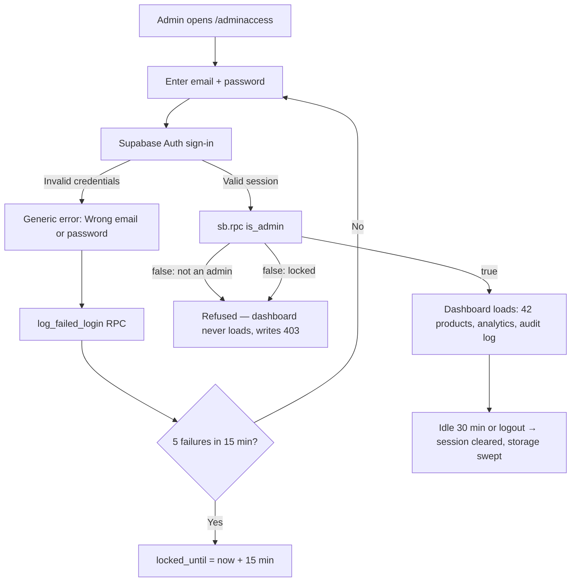
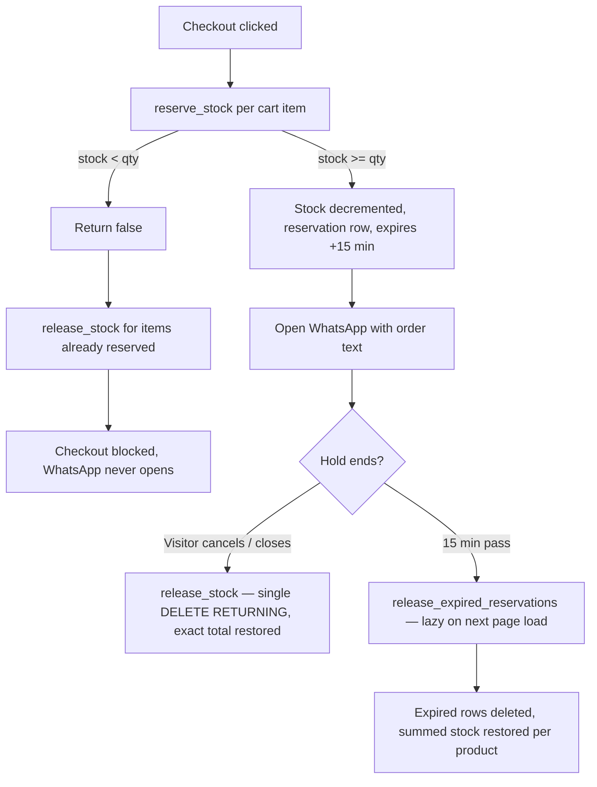

# Architecture — Imran Games

## Big picture

```
Visitor / Admin
    │  HTTPS
    ▼
Vercel (static hosting, headers + redirects)
    │  index.html / adminaccess/index.html / styles.css
    │  vendor/supabase-js (self-hosted, pinned)
    ▼
Supabase — project `imran-games` (ap-south-1)
    ├── Auth (GoTrue) — email + password, 1 admin user
    ├── Postgres + RLS — products, reservations, admins, audit_log
    ├── RPCs (SECURITY DEFINER) — reserve/release stock, is_admin, logging
    ├── Storage — `product-images` bucket (3 photos per product)
    └── Realtime — product changes push to the shop page live
    │
    ▼ (checkout only)
WhatsApp COD — order text opens WhatsApp to the shop; no order is saved
```

There is **no backend server, no build step, no framework**. Two static
pages + one stylesheet + self-hosted vendor JS do everything. All money
logic that must be trusted (stock, admin rights, lockout) runs in
Postgres as `SECURITY DEFINER` functions or RLS policies — never in the
browser. The browser never sends amounts; the server (Postgres) computes
stock changes.

## Frontend

- **Shop — `index.html` (854 lines).** Loads products live from Supabase
  (`public.products`, public SELECT), subscribes via Realtime, renders
  the grid, categories, search, quick-view modal (3 photos), cart,
  wishlist, reviews, FAQ, and the WhatsApp checkout drawer.
- **Admin — `adminaccess/index.html` (725 lines).** Hidden admin panel
  (noindexed, not in the sitemap). Login form, product add/edit/delete
  with inline price/stock editing, optimistic locking via
  `products.version`, audit-log history (latest 50), analytics
  (Chart.js, self-hosted) — summary cards, charts, activity timeline.
  All numbers are computed live from Supabase; nothing is hardcoded.
- **Styling — `styles.css`.** Single stylesheet, CSS variables, dark
  theme. See [`design.md`](design.md).
- **Vendor — `vendor/`.** Self-hosted, pinned: supabase-js 2.119.1 and
  Chart.js 4.4.1. Zero CDN dependencies for app code (the only external
  script is the hCaptcha provider script on the admin page).
- **SEO pages — `category/` (11 pages) + `products/` (42 pages).**
  Generated by `build_pages.py` from the live catalogue. Re-run after
  any price/stock change, then deploy.

## Backend — Supabase

### Tables

| Table | Purpose | Who can read / write |
|---|---|---|
| `products` | Catalogue: name, slug, category, brand, price, `was_price`, stock, `is_hot`, `is_new`, `image_urls`, `version` | Public SELECT; writes admin-only (see below) |
| `reservations` | 15-minute stock holds: `product_id`, `qty`, `session_key`, `expires_at` | No public policies — only RPCs touch it |
| `admins` | Admin flag: `user_id` → Auth user, `locked_until` | No client policies at all — only `is_admin()` reads it |
| `audit_log` | Every sign-in / failed sign-in / sign-out / product add/edit/delete, with PKT time, actor email, IP (client-supplied, display-only), user agent | Insert: authenticated; Select: admin-only |
| `orders` / `order_items` | Legacy schema, unused by the live checkout | Insertable by anon (schema only); live checkout saves no orders |

Full schema: `supabase.sql` (reviewed source of truth) + `migrations/`.

### RPCs (all `SECURITY DEFINER`, `SET search_path = public`)

| Function | What it does |
|---|---|
| `is_admin()` | Returns true iff `auth.uid()` has a row in `public.admins` **and** is not locked (`locked_until` null or past). Gates both the JS admin check and the RLS write policies. |
| `reserve_stock(p_product_id, p_qty, p_session)` | Atomically decrements stock iff `stock >= p_qty` (qty 1–10), inserts a reservation expiring in 15 minutes. Returns false if there is not enough stock. |
| `release_stock(p_product_id, p_qty, p_session)` | Single-statement `DELETE … RETURNING` of that session's reservations, then restores exactly the deleted total to stock. Parallel releases restore +1, not +2. |
| `release_expired_reservations()` | Deletes all expired reservations, restores each product's summed total, returns the count deleted. Called lazily on every shop-page load. |
| `log_failed_login(p_email, p_ip, p_ua)` | Logs a failed login, applies a per-IP throttle (10+/hour silently dropped), and locks the admin for 15 minutes after 5 failures for one email in 15 minutes. |

### RLS — the real enforcement

- `products`: public SELECT; **all writes** require
  `auth.role() = 'authenticated' AND public.is_admin()`.
- `audit_log`: insert authenticated-only; select admin-only.
- `admins`: RLS enabled, **no policies** — no client access at all.
- `reservations`: RLS enabled, **no policies** — only the RPCs touch it.

RLS policies are OR'd, so adding an admin-only policy alone does not
fix a permissive one — the permissive policies must be **dropped**.
That was the C-01 lesson; see [`security.md`](security.md).

### Auth config (not SQL)

Sign-up disabled. Password minimum 12 characters. JWT expiry 3600s,
refresh-token rotation on. Session expiry itself was never directly
observed — see [`security.md`](security.md).

## End-to-end request flows

### Shop browse

Visitor → Vercel serves `index.html` → supabase-js client (anon key,
publishable by design) → `SELECT` products → render grid → Realtime
subscription pushes any admin edit instantly. Images come from the
Supabase Storage `product-images` bucket.

### Checkout (WhatsApp COD, 15-minute hold)

1. Visitor adds items to the cart (local state only).
2. On checkout, the page calls `reserve_stock()` once per cart item.
   If any call returns false (not enough stock), it releases the
   items already reserved and **never opens WhatsApp**.
3. On success, it opens WhatsApp with the order text (items, totals,
   delivery Rs 350, free above Rs 10,000) to the shop's public number.
4. The hold expires after 15 minutes; `release_expired_reservations()`
   (lazy, on page load) restores the stock. Cancelling / closing the
   cart calls `release_stock()` for that session.
5. No order row is ever written. Anon order INSERT is blocked by RLS.

### Admin login flow



The JS `is_admin()` call is defence in depth only. Even if it were
bypassed, the RLS write policies call the same function server-side,
so a non-admin session gets 403 on every write.

### Stock-reservation flow



Why the single-statement delete matters: the old two-step
(read-then-update) version could double-restore stock if two releases
ran in parallel. The current version deletes and sums in one
statement, so parallel releases restore +1, not +2. Verified live
with a parallel-release test on 2026-11-19.

### Admin edit flow (optimistic locking)

Admin edits price/stock → page sends the row's `version` → update
succeeds only if the version still matches → version increments.
A stale save is refused instead of silently overwriting a newer edit.

## Deploy & hosting

- **Vercel project, no git link.** GitHub pushes never deploy.
  Deploy only by file upload from this folder.
- **`vercel.json`:** 308 redirects from the old hostnames to the
  canonical `imrangamesofficials.vercel.app`, `cleanUrls`, and the
  security headers (CSP, `X-Frame-Options: DENY`, `nosniff`,
  Referrer/Permissions/COOP, restricted CORS origin). 7/7 headers live
  on `/` and `/adminaccess`.
- **Old site:** `imrangames.pk` (WordPress) is untouched and compromised
  (Indonesian gambling spam; SSL expires 17 Dec 2026). It is not part
  of this project and must not be "fixed" from here.

## Known limits (by design)

- No server-side order storage, no payment gateway, no Stripe/webhooks.
- Per-session reservation cap: an anonymous visitor can temporarily
  drain stock via repeated 15-minute holds; it self-heals on expiry.
- CSP keeps `'unsafe-inline'` because the pages use heavy inline
  script/style; a strict CSP needs an external-JS refactor (out of scope).
- Session expiry never directly observed; idle-timer live test not
  testable in the cloud browser (code + harness only).
